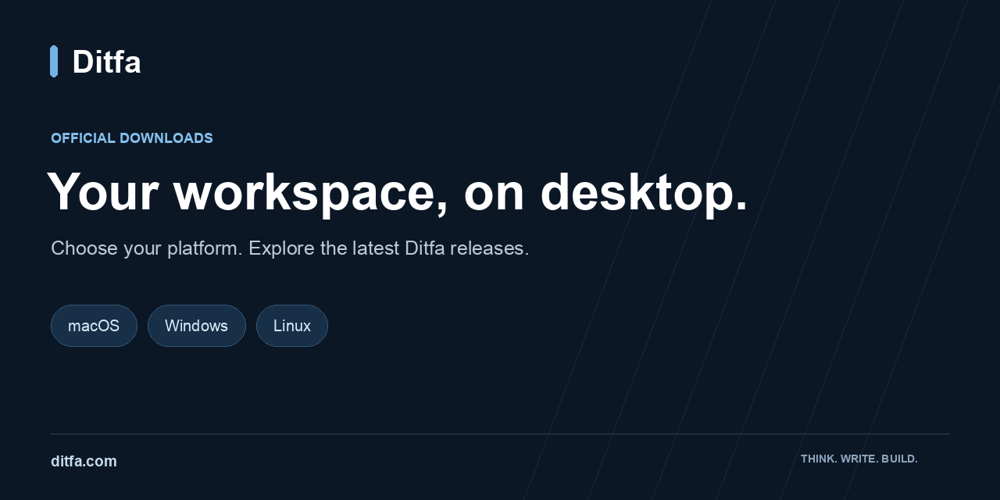

# Ditfa Downloads

**Official release assets for Ditfa Desktop and browser extension distribution.** Find installers, release notes and desktop update metadata in one place.

[Download selector](https://ditfa.com/downloads) · [Latest release](https://github.com/ditfa-dev/ditfa-releases/releases/latest) · [All releases](https://github.com/ditfa-dev/ditfa-releases/releases) · [Help](https://ditfa.com/contact)

## Get Ditfa

Use [ditfa.com/downloads](https://ditfa.com/downloads) to choose the right product and platform. For a specific desktop version, open its GitHub Release and expand **Assets**.

| Platform | Installer | Choose this for |
| --- | --- | --- |
| macOS | `.dmg` | The universal desktop build for Apple Silicon and Intel Macs |
| Windows | `x64-setup.exe` | 64-bit Windows PCs |
| Linux | `.AppImage` | A portable x64 Linux desktop download |
| Debian / Ubuntu | `_amd64.deb` | x64 distributions using Debian packages |
| Fedora / RPM | `.x86_64.rpm` | x64 distributions using RPM packages |

Asset names include the version. Availability and operating-system requirements can change between releases; check the selected release notes. Linux and Windows arm64 installers are not currently listed in the desktop release.

### Install and update

1. Download the installer for your operating system from the official download page or a release in this repository.
2. On macOS, open the disk image and move Ditfa to Applications. On Windows, run the setup executable. On Linux, install the package with your distribution's package manager, or make the AppImage executable before opening it.
3. Open Ditfa and sign in. Use the app's available update flow or revisit the download page for newer versions.

Do not bypass operating-system security warnings to install a file you cannot verify. If installation is blocked, report the platform, version and exact message through [support](https://ditfa.com/contact).

## Browser extension

The [download page](https://ditfa.com/downloads) lists current browser extension availability and installation instructions. Extension files may appear in individual releases; a desktop release does not necessarily include an extension package. Use the official listing or published package linked by Ditfa.

## Looking for the terminal agent?

[**Ditfa CLI**](https://github.com/ditfa-dev/ditfa-cli) is the open-source AI coding agent for your terminal. Its installers, source code, checksums and releases live in that separate repository.

## Understand the release assets

| Asset | Purpose |
| --- | --- |
| `.dmg`, `.exe`, `.AppImage`, `.deb`, `.rpm` | Files intended for desktop installation |
| `.app.tar.gz` | The macOS bundle used by the desktop updater |
| `.sig` | Signatures for the desktop update mechanism; these are not SHA-256 checksum files |
| `latest.json` | Machine-readable desktop update metadata; leave this file to the updater |
| GitHub's **Source code** archives | A snapshot of this documentation repository, not the desktop application source or an installer |

Not every installer has an adjacent signature file. Downloading a `.sig` alone does not verify a file. Do not treat this page as a claim that every asset is notarized, signed by the operating system, or covered by a published checksum manifest.

## Report a problem

- **Installation or download issue:** [open an issue](https://github.com/ditfa-dev/ditfa-releases/issues/new/choose), including the release tag, filename, operating system and reproduction steps.
- **Account or product help:** use [Ditfa support](https://ditfa.com/contact).
- **Security issue:** [report privately](https://github.com/ditfa-dev/ditfa-releases/security/advisories/new); see [SECURITY.md](SECURITY.md).

Remove credentials, account data and private workspace information from screenshots and logs.

## Repository scope

This repository distributes release files and installation guidance. It does not contain the desktop or browser extension application source code. Application licensing and terms are provided with the relevant product; the CLI's Apache-2.0 license does not automatically apply to these installers.
